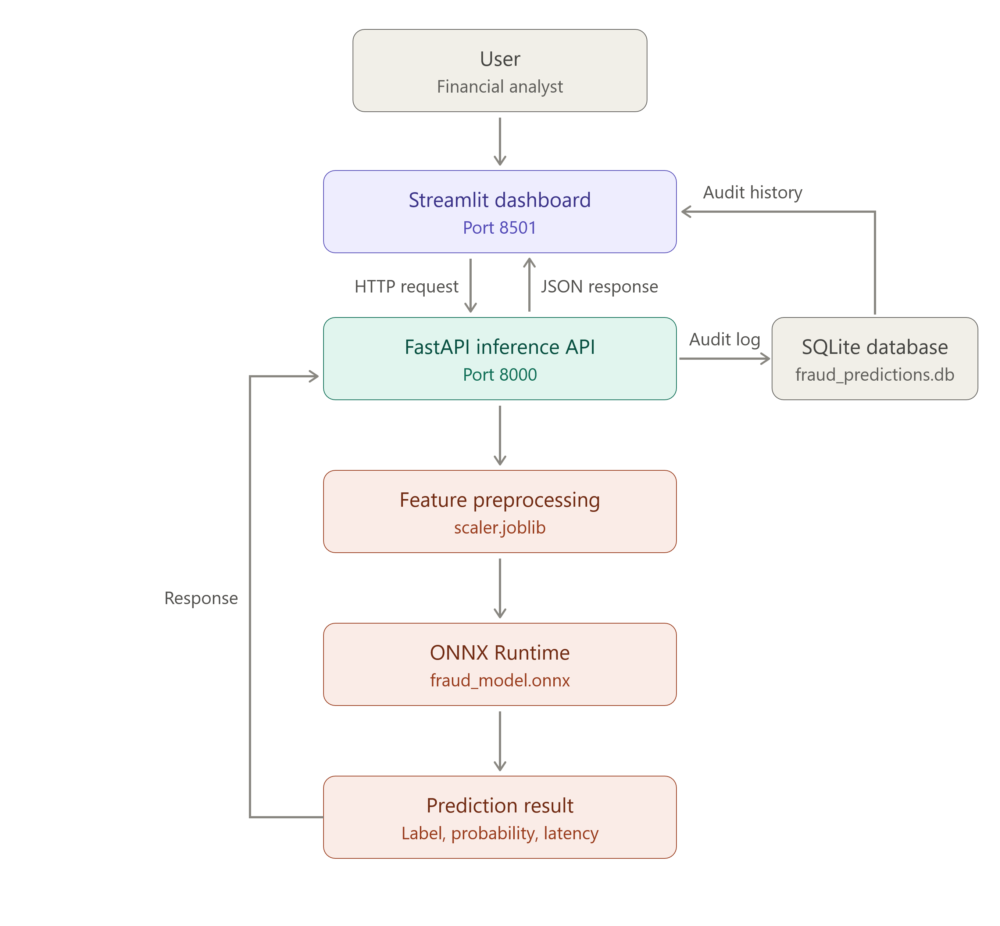

#  Real-Time Fraud Detection MLOps Pipeline

A production-grade MLOps pipeline designed for real-time credit card fraud detection with sub-5ms inference latency. The system features an ONNX-powered FastAPI backend, an interactive Streamlit monitoring dashboard, automated SQLite audit logging, full Docker Compose containerization, and a GitHub Actions CI pipeline

###  Dataset
The pipeline is built and evaluated on the benchmark European cardholders credit card fraud dataset:
* **Dataset Link:** [Credit Card Fraud Detection on Kaggle](https://www.kaggle.com/datasets/mlg-ulb/creditcardfraud)
* **Description:** Contains anonymized credit card transactions made by European cardholders. Features `V1` to `V28` are PCA-transformed features due to confidentiality, along with `Time`, `Amount`, and the target label `Class` (1 for fraud, 0 for genuine).

##  Table of Contents

- [Project Objective](#-1-project-objective)
- [System Architecture & Data Flow](#-2-system-architecture--data-flow)
- [Technology Stack](#-3-technology-stack)
- [Project Structure](#-4-project-structure)
- [How to Run](#-5-how-to-run)
- [API & Monitoring](#-6-api--monitoring)
- [Testing & CI](#-7-testing--ci)
- [Notes for Production](#-8-notes-for-production)

##  1. Project Objective

This project demonstrates a reproducible fraud detection workflow with four goals:

1. **Fast inference:** Export a trained fraud detection model to ONNX and serve predictions through FastAPI.
2. **Interactive monitoring:** Use Streamlit to simulate transactions, inspect predictions, and review audit history.
3. **Prediction auditing:** Store fraud labels, predicted probabilities, and latency measurements in SQLite using SQLAlchemy.
4. **Automated delivery:** Run the API and dashboard with Docker Compose and validate changes with Pytest and GitHub Actions.

##  2. System Architecture & Data Flow

<p align="center">
  
</p>

**Prediction flow:** The dashboard submits a transaction to FastAPI. The API validates and transforms features, runs ONNX inference, records the prediction and timing, and returns the result. The dashboard displays the result and available audit history.

##  3. Technology Stack

| Component | Technology | Purpose |
|---|---|---|
| Inference API | FastAPI + ONNX Runtime | Serve model predictions via REST |
| Dashboard | Streamlit | Simulate transactions and inspect audit logs |
| Persistence | SQLite + SQLAlchemy | Store prediction and latency records |
| Model preprocessing | scikit-learn + joblib | Apply the saved feature scaler |
| Containerization | Docker + Docker Compose | Run isolated services |
| Tests and CI | Pytest + GitHub Actions | Automate validation on code changes |

##  4. Project Structure

```text
fraud-mlops-pipeline/
├── .github/
│   └── workflows/
│       └── ci.yml               # GitHub Actions CI workflow
├── config/
│   └── database.py              # Database connection and sessions
├── data/
│   └── test_data.csv            # Sample test data
├── models/
│   ├── fraud_model.onnx         # Exported ONNX model
│   └── scaler.joblib            # Saved feature scaler
├── src/
│   ├── app.py                   # FastAPI application and endpoints
│   ├── dashboard.py             # Streamlit dashboard
│   ├── data_preprocess.py       # Feature preparation
│   ├── db_models.py             # SQLAlchemy database models
│   ├── schemas.py               # Pydantic request/response schemas
│   └── train.py                 # Training and ONNX export
├── tests/
│   └── test_api.py              # API tests
├── .gitignore
├── docker-compose.yml
├── Dockerfile
├── pytest.ini
└── requirements.txt
```

##  5. How to Run

### Option 1: Docker Compose (Recommended)

**Prerequisites:** Docker Engine or Docker Desktop with Docker Compose installed.

1. Clone the repository:

   ```bash
   git clone https://github.com/Diraribnsalah/fraud-mlops-pipeline.git
   cd fraud-mlops-pipeline
   ```

2. Build and start the services:

   ```bash
   docker compose up -d --build
   ```

3. Open the applications:

   | Service | URL |
   |---|---|
   | FastAPI interactive documentation | http://localhost:8000/docs |
   | Streamlit dashboard | http://localhost:8501 |

4. Inspect logs if needed:

   ```bash
   docker compose logs -f
   ```

5. Stop and remove the containers:

   ```bash
   docker compose down
   ```


### Option 2: Local Development (Without Docker)

**Prerequisites:** Python 3.10+ and pip.

1. Clone the repository and enter its directory (as shown above).

2. Create a virtual environment:

   **Linux / macOS**

   ```bash
   python3 -m venv venv
   source venv/bin/activate
   ```

   **Windows PowerShell**

   ```powershell
   python -m venv venv
   .\venv\Scripts\Activate.ps1
   ```

3. Install dependencies:

   ```bash
   python -m pip install --upgrade pip
   pip install -r requirements.txt
   ```

4. Start the FastAPI server:

   ```bash
   uvicorn src.app:app --host 127.0.0.1 --port 8000 --reload
   ```

5. In a **second terminal**, activate the same virtual environment and start Streamlit:

   ```bash
   streamlit run src/dashboard.py
   ```

6. Run the test suite:

   ```bash
   pytest
   ```


##  6 . API & Monitoring

FastAPI exposes interactive API documentation at **http://localhost:8000/docs**. Consult the documented endpoint paths and Pydantic schemas there for the exact prediction request and response format.

The Streamlit interface is intended to support transaction simulation, prediction inspection, and review of saved audit records. Available features depend on the implementation in `src/dashboard.py`.

**Latency interpretation:** Distinguish ONNX model execution time from full HTTP request time, which also includes validation, preprocessing, serialization, and database operations.

##  7. Testing & CI

Run tests locally:

```bash
pytest -v
```
The `.github/workflows/ci.yml` workflow is intended to execute automated tests on repository changes. Check its configured triggers and steps for the exact behavior.

Recommended validation includes successful prediction requests, invalid-input handling, model artifact loading, and database audit writes.

##  8. Notes for Production

This repository is an MLOps demonstration. Before deploying in a real financial environment:

- **Validate model quality:** Report precision, recall, PR-AUC, false-positive rates, and evaluation on representative data.
- **Benchmark performance:** Record hardware, batch size, test methodology, and percentile latencies (p50/p95/p99).
- **Protect financial data:** Avoid storing raw sensitive card details; add access controls, secret management, and encryption as appropriate.
- **Improve operational resilience:** Consider database migrations, observability, health checks, retry behavior, and a production-grade database for concurrent workloads.
- **Document model provenance:** Record dataset source, training procedure, versioned artifacts, and any model optimization or quantization actually performed.

---

**Status:** Project documentation based on the described architecture. Verify service configuration, implemented endpoints, and measured performance against the source code before release.


          
